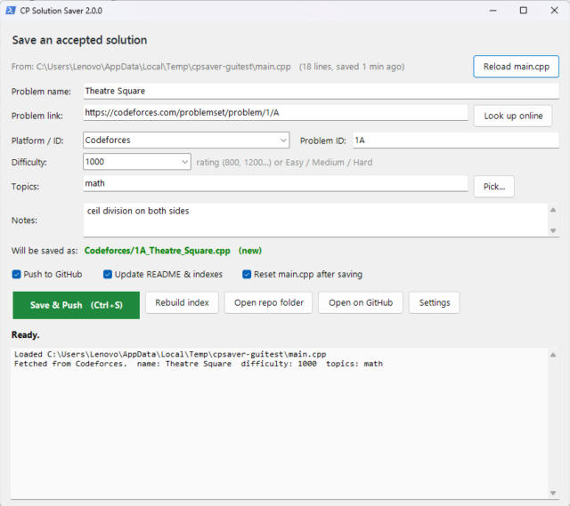
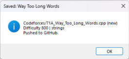
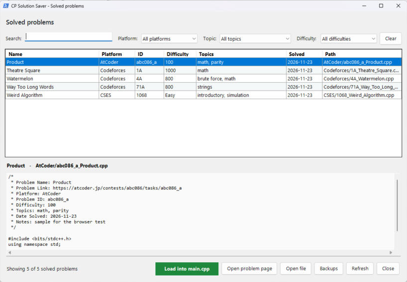
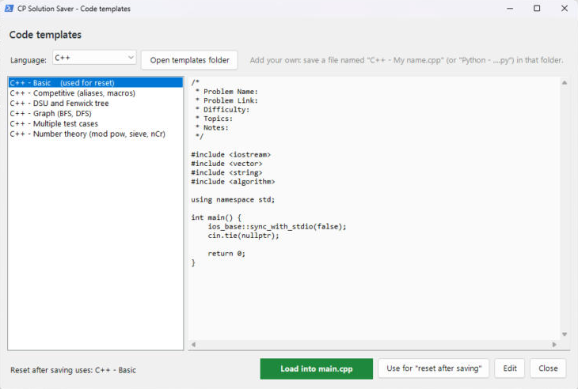

# CP Solution Saver

Save an accepted competitive-programming solution from your practice file
(`main.cpp`, `main.c` or `main.py`) to your GitHub solutions repo **with one click**: it gets a clean file name, the
right folder, a complete header (name, link, difficulty, topics, date), and it
is listed in auto-generated indexes **by platform, by topic and by difficulty**.

Two ways to save: the **window** (check and edit everything first) or **quick save**
(one hotkey, no window, a message box tells you what happened). After saving, your practice
file is reset to a **code template** for the next problem. When you want to study an old
problem, **search your solved problems** and load one back.

Made for a Visual Studio practice project on Windows (any editor works: the app only needs the
file). C++, C and Python. No admin rights, no extra software besides Git.

**Fast:** a tiny helper waits in the system tray, so the shortcuts open windows instantly
(about 0.01 s to reach the app, instead of 2-4 s to start PowerShell every time), and online
lookups and GitHub pushes run in the background so the window never freezes.



---

## Contents

1. [What it does](#what-it-does)
2. [Install](#install)
3. [Daily use](#daily-use)
   - [Shortcuts and the tray icon](#shortcuts-and-the-tray-icon)
4. [Quick save (no window)](#quick-save-no-window)
5. [Solved problems: search and load back](#solved-problems-search-and-load-back)
6. [Several languages (C++, C, Python)](#several-languages-c-c-python)
7. [Code templates](#code-templates)
8. [The problem header](#the-problem-header)
9. [Same problem again: how it is recognized](#same-problem-again-how-it-is-recognized)
10. [How the solutions repo is organized](#how-the-solutions-repo-is-organized)
11. [Settings](#settings)
12. [Visual Studio button (optional)](#visual-studio-button-optional)
13. [Console mode](#console-mode)
14. [Testing](#testing)
15. [Uninstall](#uninstall)
16. [Troubleshooting](#troubleshooting)
17. [Project layout](#project-layout)

---

## What it does

- **Reads the header** at the top of your practice file (problem name, **link (required)**, difficulty, topics, notes).
- **Looks the problem up online** from the link, filling in what you left empty:
  - Codeforces: name, rating, tags
  - LeetCode: name, number, Easy/Medium/Hard, topic tags
  - AtCoder, CSES and others: name
- **Saves** the code into your solutions repo, e.g. `Codeforces/4A_Watermelon.cpp`,
  with a normalized header including the date solved.
- **Never duplicates**: the problem link identifies the problem, so saving it again updates the
  existing file (even if the link is written differently), and it keeps the original solve date.
  You can also choose to keep both (`_v2`).
- **Updates the indexes**: README progress section, `Index/BY_PLATFORM.md`,
  `Index/BY_TOPIC.md`, `Index/BY_DIFFICULTY.md`.
- **Commits and pushes** (`git pull --rebase` first, so pushes don't get rejected),
  with messages like `Add Codeforces 4A - Watermelon` and the topics/difficulty in the body.
- **Resets the practice file** to a code template for the next problem (on by default, can be turned off).
- **Quick save**: `Ctrl+Alt+Shift+F` does all of the above with no window and shows the result in a message box.
- **Several languages**: C++, C, Python (and Java/JS/C#/Go/Rust/Kotlin files are understood too).
- **Code templates**: 11 built-in templates (basic, multiple tests, competitive, graph, number theory,
  DSU/Fenwick, C, Python), plus your own; pick which one "reset" uses per language.
- **Solved problems browser**: search by name, filter by platform / topic / difficulty, preview the code,
  and load a solution back into `main.cpp` (your current file is backed up first).

## Install

Requirements: Windows 10/11 and [Git for Windows](https://git-scm.com/download/win) (default options).
PowerShell 5.1 is built into Windows. A GitHub account is **optional**.

1. Get this repo: `git clone https://github.com/MostafaSamyFayez/CP-Solution-Saver.git`
   (or *Code → Download ZIP* and unzip).
2. Double-click **`install.bat`** (if Windows SmartScreen appears: *More info* > *Run anyway*).
3. A short **welcome tour** explains the header and the shortcuts, then **Settings** opens. Choose:
   - **Practice files**: the file you solve problems in, one per language (`main.cpp`, and if you
     like `main.c`, `main.py`).
   - **Solutions folder**: **any empty folder** (use *Make New Folder* in the folder picker). It becomes
     a new local repo automatically. Already have a solutions repo on GitHub? Use **Clone a GitHub repo...**.
     Want one on GitHub right away? **Create a new GitHub repo...**.
4. The first time you save, if Git doesn't know your **name and email** yet, a small window asks for
   them (one time per PC; Git records them with every save).

See the tour again any time: tray icon > **How to use...** (or the *How to use* button in the window).

### Without GitHub, and connecting it later

Everything works on your PC alone: saves are kept in the local repo (the result says
*commit kept locally*). When you want them on GitHub, open **Settings > Connect this folder to
GitHub...**: it creates a new repo on your account (or uses an empty one you made) and uploads
everything saved so far; from then on every save uploads automatically.

The installer:

| What | Where |
|---|---|
| App files | `%LOCALAPPDATA%\Programs\CPSolutionSaver` |
| Settings, templates, backups | `%APPDATA%\CPSolutionSaver\` (`config.json`, `templates\`, `backups\`) |
| Start Menu | *CP Solution Saver* folder (app, Settings, Read me, Uninstall) |
| Desktop | *CP Solution Saver* shortcut |
| Tray app | `CPSaverLauncher.exe` + `CPSaver.Native.dll`, built at install time with the C# compiler that ships with Windows; starts with Windows (optional) |
| Hotkeys | **Ctrl+Alt+Shift+S** save window, **Ctrl+Alt+Shift+F** quick save, **Ctrl+Alt+Shift+B** solved problems |
| Start Menu extras | *Quick Save*, *Solved problems*, *Code templates*, *How to use*, *Settings*, *Read me*, *Uninstall* |

You can also install non-interactively:

```powershell
.\install.ps1 -MainCpp "C:\path\to\main.cpp" -RepoPath "C:\Users\me\Desktop\Problem-Solving-Solutions"
.\install.ps1 -PracticeFile "C:\path\to\main.cpp", "C:\path\to\main.py"     # several languages
```

Updating = `git pull` in this repo and run `install.bat` again (your settings are kept; the
running tray app is restarted automatically).

## Shortcuts and the tray icon

After installing, CP Solution Saver runs quietly in the **system tray** (the icon with `</>` and a
green check, next to the clock; it may be under the `^` arrow). It uses almost no memory and keeps
the app ready, so everything opens immediately.

| Shortcut | Does |
|---|---|
| **Ctrl+Alt+Shift+S** | open the save window |
| **Ctrl+Alt+Shift+F** | quick save (no window) |
| **Ctrl+Alt+Shift+B** | open Solved problems |

Right-click the tray icon for every action (save, quick save, solved problems, templates,
settings, open the repo folder / GitHub, exit); double-click it to open the save window.
The Start Menu entries and the Desktop shortcut do the same and are just as fast (if the tray app isn't running, the first one starts it in about half a
second). Turn *Start with Windows* on or off in Settings.

## Daily use

1. Solve the problem in your practice file. Fill at least the **link** in the header (required;
   the name, difficulty and topics are fetched for Codeforces/LeetCode).
2. Submit. When it's **Accepted**, save the file (**Ctrl+S** in Visual Studio).
3. Press **Ctrl+Alt+Shift+S** (or double-click the tray icon, or the Desktop shortcut).
4. Check the fields, add topics with **Pick...** if you like, then **Save & Push** (or Ctrl+S in the app).
5. Done: the status line says *"... is on GitHub"*, the practice file is reset to its template,
   and the window closes itself (you can turn that off).

The *Will be saved as* line tells you whether the problem is **new**, **solved before** (and when;
it will be updated) or solved before **in another language**.

Window shortcuts: **Ctrl+S** save & push, **F5** reload, **Esc** close.

If the file changed after the window opened, it tells you; the newest code on disk is always what gets saved.

## Quick save (no window)

When the header is already right, skip the window:

1. Save your practice file (Ctrl+S).
2. Press **Ctrl+Alt+Shift+F** (or tray icon > *Quick save*, or Start Menu > *CP Solution Saver - Quick Save*).
3. A message box in the middle of the screen shows the result, for example:

   

   While it works, a small *"Saving main.cpp ..."* box shows that it's busy. **Open on GitHub**
   opens the saved file on GitHub.

Quick save uses the practice file you saved most recently, and exactly the same steps as the
window (header + online lookup, duplicate check, indexes, pull/commit/push, reset to template)
with your Settings defaults, and asks nothing. Other results:

| Message | Meaning |
|---|---|
| *Already saved: ...* | This exact solution is already in the repo; nothing was pushed. |
| *Quick save failed* | No problem link / name, a push failed, etc. It explains why and offers to open the full window (**Open CP Solution Saver**). |

Prefer a Windows notification in the corner instead? Settings > *Quick save: show a Windows
notification*. The full log of the last quick save is in `%APPDATA%\CPSolutionSaver\last-quick-save.log`.

## Solved problems: search and load back

Open it with **Ctrl+Alt+Shift+B**, the **Solved problems...** button in the window, the tray menu, or
Start Menu > *CP Solution Saver - Solved problems*.



- **Search** box: matches name, problem ID, platform, topics, notes, file name and link (several words = all must match). `Ctrl+F` jumps to it.
- **Platform / Topic / Difficulty / Language** filters (built from what you've solved); **Clear** resets them.
- Click a column header to sort (Difficulty sorts by rating, then Easy/Medium/Hard).
- The lower half previews the selected solution.
- **Load into practice file** (or double-click / Enter): asks first, **backs up your current file**
  to `%APPDATA%\CPSolutionSaver\backups` (the newest 30 are kept; **Backups** button opens the folder),
  then puts the solution into the practice file **of its language** (`.py` solutions go into `main.py`).
  Visual Studio asks to reload the file: choose **Yes**.
- **Open problem page** / **Open file** for the selected problem.

A loaded solution keeps its header, so if you improve it and save again it **updates the same file**.

## Several languages (C++, C, Python)

Add one practice file per language in **Settings > Practice files** (for example `main.cpp`,
`main.c`, `main.py`). The app always works on the one **you saved most recently**, and you can
switch with the *Practice file* dropdown at the top of the window.

- The saved file keeps its language: `Codeforces/4A_Watermelon.py`, `CSES/1083_Missing_Number.c`.
- The same problem solved in two languages gives two files side by side; the window says
  *solved before in C++* so you know.
- Each language has its own reset template.
- Solved problems can be filtered by language, and load back into the matching practice file.

## Code templates



Open **Templates...** in the window (or in Settings). Built in:

| Language | Templates |
|---|---|
| C++ | Basic (your includes + fast I/O), Multiple test cases, Competitive (aliases, macros, `LOCAL_INPUT` for `input.txt`), Graph (BFS, DFS), Number theory (mod pow, inverse, sieve, nCr), DSU and Fenwick tree |
| C | Basic, Multiple test cases |
| Python | Basic, Fast input (`sys.stdin.readline`), Multiple test cases |

All of them compile with Visual Studio's default settings (no `bits/stdc++.h`, no C++17-only features).

- **Load into main.cpp / main.py**: replaces the practice file with the template (backup first).
- **Use for "reset after saving"**: that template is what the practice file is reset to after each save.
- **Edit** opens it in Notepad. **Open templates folder** to add your own: a file named
  `C++ - Segment tree.cpp` or `Python - Graphs.py` appears in the list automatically.
  Your edits are never overwritten by updates.

## The problem header

Put this comment at the very top of the practice file (the templates already have it):

```cpp
/*
 * Problem Name: Watermelon
 * Problem Link: https://codeforces.com/problemset/problem/4/A
 * Difficulty: 800
 * Topics: math, brute force
 * Notes: w must be even and > 2
 */
```

| Field | Required | Notes |
|---|---|---|
| `Problem Name` | yes* | *fetched from the link for Codeforces/LeetCode/AtCoder/CSES |
| `Problem Link` | **yes** | identifies the problem (see below), decides the platform folder and the problem ID |
| `Platform` | no | detected from the link; set it for judges that aren't recognized |
| `Problem ID` | no | detected (e.g. `4A`, `abc300_a`, `1068`) |
| `Difficulty` | no | a rating (`800`, `1400`) or `Easy` / `Medium` / `Hard` |
| `Topics` | no | comma separated; merged with the online tags |
| `Notes` | no | can span several lines |

Python files use a docstring instead (the Python templates already have it):

```python
"""
Problem Name: Watermelon
Problem Link: https://codeforces.com/problemset/problem/4/A
Topics: math
"""
```

`// Key: value` or `# Key: value` comment lines at the top work too.
Aliases work: `Name`, `Link`/`URL`, `Tags`, `Rating`/`Level`, `Date`.
Any other `Key: value` line (e.g. `Time Complexity: O(n)`) is kept in the saved file.

Saved files get a complete header:

```cpp
/*
 * Problem Name: Watermelon
 * Problem Link: https://codeforces.com/problemset/problem/4/A
 * Platform: Codeforces
 * Problem ID: 4A
 * Difficulty: 800
 * Topics: math, brute force
 * Date Solved: 2026-11-23
 * Notes: w must be even and > 2
 */
```

Recognized platforms: Codeforces (contest, problemset, gym), LeetCode, AtCoder, CSES,
CodeChef, SPOJ, Kattis, HackerRank, VJudge, UVa, Eolymp. Anything else goes to `Other/`.

## Same problem again: how it is recognized

The **problem link is the problem's identity** (that's why it is required):

- Different spellings of the same link are the same problem: `codeforces.com/contest/4/problem/A`
  = `codeforces.com/problemset/problem/4/A`; `leetcode.com/problems/two-sum/description/` =
  `leetcode.com/problems/two-sum`; `http`/`https`, `www.`, `?query` and trailing `/` don't matter.
- Saving a problem that's already in the repo (same language) **updates that file**, even if you
  renamed the problem. Tick *Keep the old solution too* to save it as `_v2` instead.
- The update keeps the **date it was first solved** and the **link as first written** (unless you
  wrote a `Date Solved:` yourself). So saving the same code again, on another day, gives
  *"Already saved - nothing new to push"* instead of a fake new submission. If the code or the
  topics/notes changed, it is committed as *Update ...*.

## How the solutions repo is organized

```
Problem-Solving-Solutions/
├── README.md               <- your intro + auto "Progress" section (counts, top topics, recent)
├── Index/
│   ├── BY_PLATFORM.md      <- every problem, grouped by platform
│   ├── BY_TOPIC.md         <- grouped by topic (dp, greedy, graphs, ...)
│   └── BY_DIFFICULTY.md    <- grouped by rating / Easy-Medium-Hard
├── Codeforces/
│   └── 4A_Watermelon.cpp
├── LeetCode/
│   └── 0001_Two_Sum.cpp
├── AtCoder/  CSES/  Other/ ...
```

**Why folders by platform, and indexes for topic/difficulty?** A problem usually has
several topics, so topic folders would mean copies of the same file. The platform is
unique, so it's the folder; topics and difficulty are browsable through the generated
index pages (with links to both the problem and your solution). The indexes are rebuilt
from the file headers, so if you edit a header by hand, click **Rebuild index**.

Only the part of README.md between `<!-- CPSAVER:STATS:START -->` and
`<!-- CPSAVER:STATS:END -->` is generated; write anything you want around it.

## Settings

Open **Settings** in the window or *CP Solution Saver - Settings* in the Start Menu.

- **Practice files** (one per language) and the solutions repo folder (plus *Clone* / *Create new GitHub repo*)
- **Templates...**: choose the reset template per language, load or edit templates
- Look up problems online (on by default)
- Push after saving (on), update indexes (on), **reset the practice file after a successful save (on)**,
  close the save window after saving (on)
- **Start with Windows** (on): keeps the tray app running so the shortcuts are instant
- Quick save: message box (default) or Windows notification
- **Add Difficulty/Topics fields to my practice files' headers**: upgrades old headers without touching your code

Settings live in `%APPDATA%\CPSolutionSaver\config.json`.

## Visual Studio button (optional)

The global hotkey already works inside Visual Studio. If you also want a menu item:

1. **Tools → External Tools... → Add**
2. Title: `Save Solution`
3. Command: `C:\Windows\System32\wscript.exe`
4. Arguments: `"C:\Users\<you>\AppData\Local\Programs\CPSolutionSaver\CPSaver.vbs"`
5. OK. It appears in the **Tools** menu. To give it a shortcut: **Tools → Options →
   Environment → Keyboard**, search `Tools.ExternalCommand1` (the number = its position in the list).

Remember to save (`Ctrl+S`) before using it.

## Console mode

```bat
cpsaver.cmd -Cli                 :: shows what will be saved, asks, saves and pushes (newest practice file)
cpsaver.cmd -Cli -MainCpp X.py   :: same, for a specific file
cpsaver.cmd -Cli -Yes            :: no questions
cpsaver.cmd -Cli -NoFetch        :: don't look the problem up online
cpsaver.cmd -Cli -NoPush         :: commit only
cpsaver.cmd -Cli -KeepBoth       :: keep the older solution too (_v2)
cpsaver.cmd -RebuildIndex        :: regenerate README progress + Index/*.md, commit, push
cpsaver.cmd -Settings            :: open the settings window
cpsaver.cmd -Quick               :: quick save: no window, notification with the result
cpsaver.cmd -Quick -NoNotify     :: quick save, result printed only (for scripts)
cpsaver.cmd -Browse              :: open the solved-problems browser
cpsaver.cmd -Version
```

`cpsaver.cmd` is in the install folder (`%LOCALAPPDATA%\Programs\CPSolutionSaver`).

## Testing

Double-click **`run-tests.bat`** (or `powershell -ExecutionPolicy Bypass -File tests\Run-Tests.ps1 -Online`).
The tests create a temporary repo with a local remote, so your real repo and GitHub are never touched.
They cover header parsing, platform detection, saving/updating/keep-both, indexes, template reset,
console mode end to end, quick save, loading a solution back with backups, C/Python files,
link identity, the first-solve-date rule, templates, settings migration, and (with `-Online`)
the Codeforces/LeetCode/CSES/AtCoder lookups (83 checks).

## Uninstall

Start Menu → *CP Solution Saver* → **Uninstall CP Solution Saver**
(or run `uninstall.bat` in the install folder). App files and shortcuts are removed;
your solutions repo is never touched. Settings are kept unless you run
`uninstall.ps1 -RemoveSettings`.

## Troubleshooting

| Problem | Fix |
|---|---|
| *git push failed* | Your commit is saved locally. Run `git push` in the repo folder once to sign in, then use the app again. |
| *Online lookup failed* | No internet or the site is slow; fill the fields by hand. Codeforces data is cached for a day. |
| Wrong folder / name | Edit the fields in the window before saving, or set `Platform:` / `Problem ID:` in the header. |
| Hotkey does nothing | Is the tray icon there? If not, open CP Solution Saver from the Start Menu (it starts the tray app). If it says a shortcut is *used by another app*, use the tray menu or the Start Menu entries instead. |
| Want to stop it running in the background | Right-click the tray icon > *Exit*, and untick *Start with Windows* in Settings. |
| No quick-save notification | Only if you switched to notifications: Focus Assist may hide them. Switch back to the message box in Settings, or read `%APPDATA%\CPSolutionSaver\last-quick-save.log`. |
| Loaded the wrong solution / template | Your previous file is in the **Backups** folder (Solved problems window). |
| Visual Studio asks to reload main.cpp | Expected after a reset or a load; choose **Yes**. |
| Quick save used the wrong language | It uses the practice file saved most recently: save the one you mean (Ctrl+S) first. |
| *The problem link is required* | Add `Problem Link: https://...` to the header; it's how the app knows which problem it is. |
| "running scripts is disabled" | Use the shortcuts / `install.bat`: they pass `-ExecutionPolicy Bypass` for this app only. |

## Project layout

```
src/CPSaver.ps1        entry point (window, console mode, quick save, tray host, rebuild index)
src/CPSaver.Tray.ps1   tray host: hotkeys, tray menu, commands from the launcher
src/native/*.cs        C# sources of CPSaverLauncher.exe and CPSaver.Native.dll (built by install.ps1)
src/CPSaver.Core.psm1  all logic: header, languages, platforms, problem identity, online lookup,
                       saving, git, indexes, templates, quick save, backups
src/CPSaver.Gui.ps1    Windows Forms windows (theme, save, settings, topics, templates, solved problems,
                       result window), background jobs
install.ps1 / .bat     per-user installer
uninstall.ps1          uninstaller
tests/Run-Tests.ps1    self-tests
docs/                  screenshots
```

## License

MIT, see [LICENSE](LICENSE).
